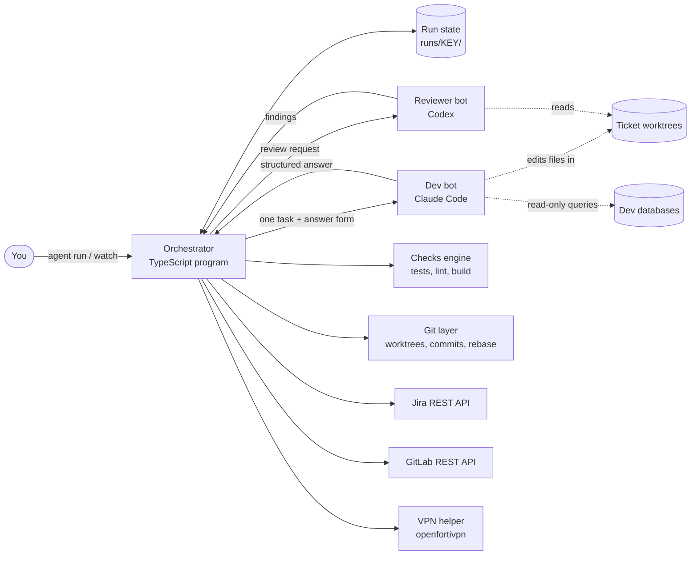
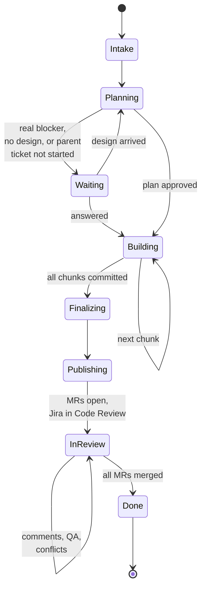
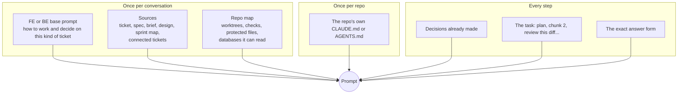
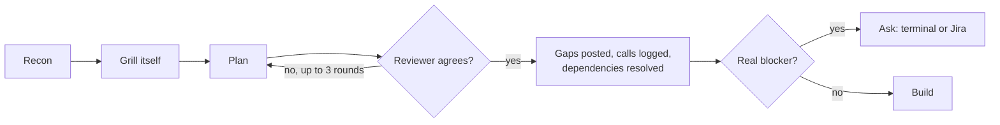
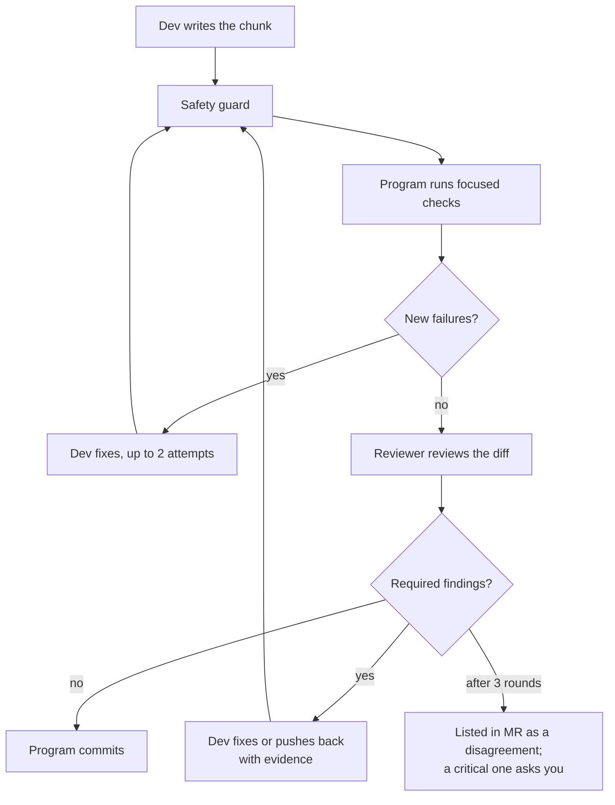
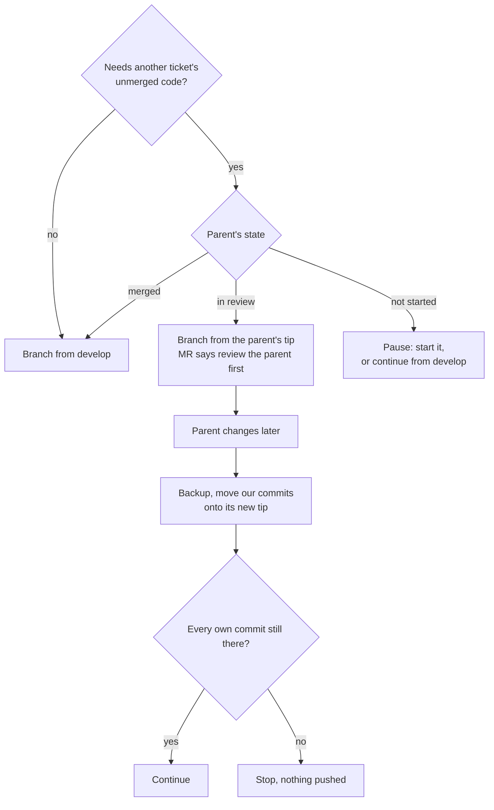
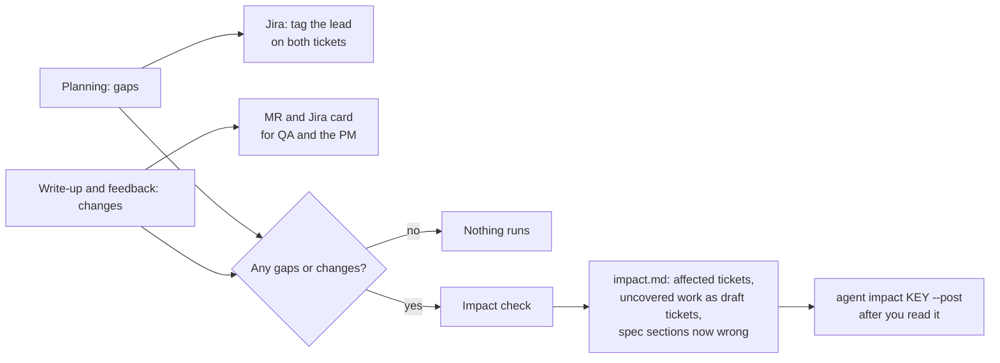
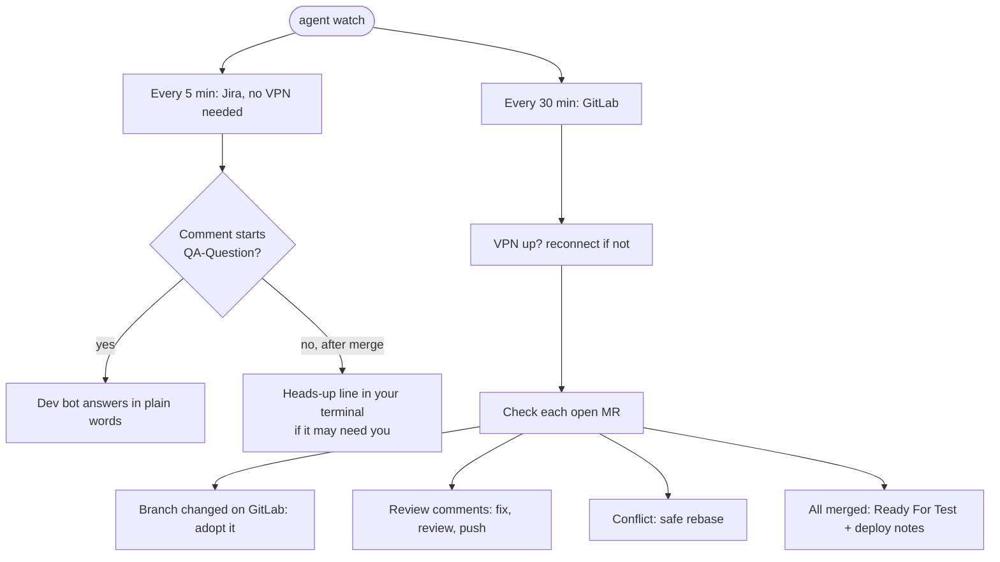
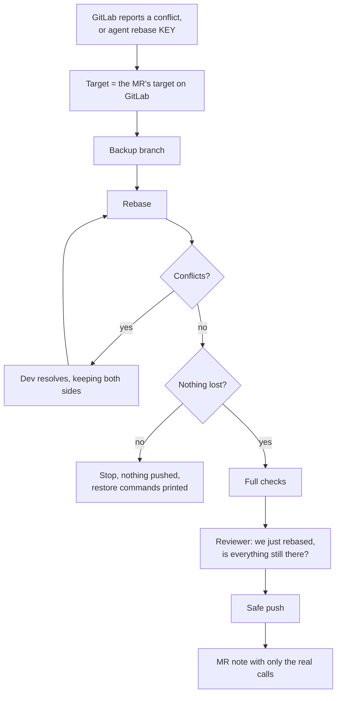
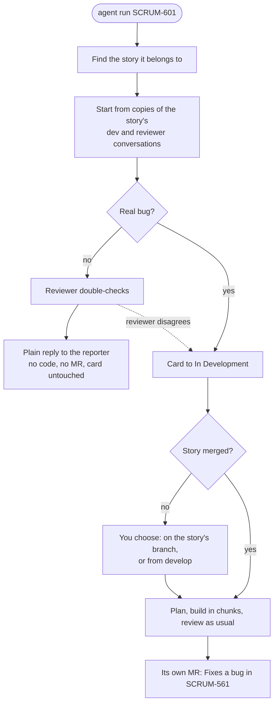

# How closio-agent works, and why

Every part of the pipeline, from the core design down to small additions like VPN auto-connect, with the reasoning behind each choice. For setup and daily use, start with the [README](../README.md); read this when you want to understand or change how it works.

---

## 1. In one paragraph

closio-agent is a command-line tool that takes a Jira ticket and turns it into reviewed, tested merge requests, then keeps looking after them until the ticket is done. A plain TypeScript program (the **orchestrator**) runs every ticket through fixed stages. Inside those stages it uses two AI coding agents: **Claude Code** as the developer and **Codex** as an independent reviewer. The program, not the AI, runs the tests, does all the git work, talks to Jira and GitLab, and enforces the safety rules. A person is asked only when a decision genuinely needs one, and a person always merges.

```
agent run SCRUM-561
```

That one command does: read the ticket and everything around it → plan → build in reviewed chunks → test → open MRs → update Jira. A second command, `agent watch`, then handles review comments, QA questions, conflicts and the merge.

---

## 2. Goals and principles

**Goal:** automate the work *around* coding, not just the code: recon, reading the techspec, matching the other side of the API, review rounds, rebases, MR descriptions, Jira updates, deploy notes, answering QA.

**Principles that shaped every decision:**

1. **Code decides the flow; AI decides the content.** A ticket's steps are known, so a program runs them. The AI is only ever asked to do one bounded task at a time.
2. **Two different models.** The dev and the reviewer are different AIs, so they have different blind spots. A model reviewing its own work tends to agree with itself.
3. **Measure, don't trust.** The program runs the tests itself and compares against a baseline. The MR only claims what actually ran.
4. **Enforce, don't ask.** Safety rules are enforced by permissions and by the program undoing things, not by instructions in a prompt.
5. **Humans only where they add value.** No approving every plan. Questions only for real blockers. Humans always merge.
6. **Resumable.** Every step is saved. A crash, laptop sleep or a question just pauses the run.
7. **Work like the team works.** Our branching (Edit built on Add), our repo conventions, our tests, our Jira statuses, our language (Bahasa Indonesia UI copy), our tone.

---

## 3. Architecture

### 3.1 Components



| Component | What it is | What it does |
|---|---|---|
| **Orchestrator** | TypeScript on Node 22, no build step (Node's native type stripping) | Runs the stages, keeps state, calls the bots, runs checks, does git, Jira and GitLab |
| **Dev bot** | Claude Code CLI (`claude -p`) | Recon, planning, writing code, fixing review findings, resolving conflicts, writing the MR text, answering QA |
| **Reviewer bot** | OpenAI Codex CLI (`codex exec`) | Reviews the plan, every chunk, the whole ticket, rebases and feedback fixes. Read-only. |
| **Simplifier** | Claude (separate, fresh each time) | One cleanup pass after all chunks |
| **Planner** | Claude (strongest model) | Only for `agent sprint-plan`, the whole-sprint report |
| **Checks engine** | Part of the program | Runs each repo's tests, lint and build; compares with a baseline |
| **Git layer** | Part of the program | Worktrees, commits, pushes, rebases, backups, guards |
| **Jira / GitLab clients** | Part of the program | REST APIs; the bots never talk to them directly |
| **Helpers** | `bin/agent-sql`, `bin/agent-jira` | The only two scripts a bot may run: read-only SQL, and fetching another Jira ticket |

### 3.2 Tech stack

- **TypeScript on Node 22**, run directly (no compile step). Same language as our BE, easy for the team to read.
- **zod** for every data shape. Each bot answer has a zod schema, converted to JSON Schema and enforced by the bot's CLI.
- **yaml** for config, **vitest** for the pipeline's own tests (39 passing).
- External tools used: `git`, `claude`, `codex`, `pdftotext` (from poppler, for techspec PDFs), `psql` (for read-only queries), `openfortivpn` (VPN).

### 3.3 Where things live

```
closio-agent/
  agent.config.yaml      team config, committed: repos, branches, checks, protected files,
                         Jira statuses, model profiles, limits
  agent.local.yaml       per developer, never committed: repo paths on your laptop,
                         draft MRs while testing, default profile, VPN settings
  .env                   secrets, never committed: Jira and GitLab tokens, dev DB logins
  prompts/               FE and BE base prompts (dev/, reviewer/), step templates, design variants
  src/                   orchestrator, clients, checks, git, sprint logic
  bin/                   agent (CLI), agent-sql, agent-jira
  runs/KEY/              everything about one ticket: inputs, plan, build,
                         MR text, its code copies (code/), its handoff note
  sprints/               sprint maps and sprint plans
```

### 3.4 Repos it knows

| Key | Repo | Role | Branch it starts from and MRs target |
|---|---|---|---|
| `frontend` | closio-web-v2 | Vue 3 + Vite + Pinia + Vuetify web app | `development` |
| `ws1` | nodejs-ws1closio | Gateway (BFF): session, forwards to WS2, no business rules | `develop` |
| `ws2targetsales` | nodejs-ws2targetsales | Target Sales and Incentive Engine, Postgres | `develop` |
| `ws2notifications` | nodejs-ws2notification | Notifications service | `develop` |
| `ws2pricingengine`, `ws2closio` | | configured, set up per laptop | `develop` |

The bot is told each repo's role ("WS1 is the gateway, WS2 owns business rules, validation order, persistence and response shape"), so it puts code in the right layer.

---

## 4. The orchestrator

### 4.1 What it is

A plain program with a fixed sequence of stages. Its main loop reads the ticket's current stage from the saved state, runs that stage, saves, and moves to the next one. It never asks an AI "what should happen next".

### 4.2 Stages



| Stage | What happens |
|---|---|
| **Intake** | Gathers the ticket and everything around it; prepares repo copies; records which tests already fail. No AI. |
| **Planning** | Dev bot recons and plans; reviewer challenges it; gaps raised; dependencies resolved. |
| **Waiting** | Only when a person must answer something; the process exits cleanly and resumes later. |
| **Building** | The chunk loop: write, check, review, fix, commit. One chunk at a time. |
| **Finalizing** | Full checks, whole-ticket audit, cleanup pass, alignment, write-up (changes, QA notes, handoff note, deploy notes, impact). |
| **Publishing** | Push, MRs, Jira to Code Review. |
| **In review** | Watched by `agent watch` until merged. |
| **Done** | Card moved to Ready For Test, deploy notes posted. |

### 4.3 Resume and pause

- The state (`runs/KEY/.agent/state.json`) is saved after every meaningful step, written atomically so a crash mid-write can't corrupt it.
- Any stop (a crash, laptop sleep, Ctrl+C, a question) leaves the state where it was. `agent run KEY` continues from the same step.
- A chunk that was approved but whose commit failed (for example a git hook) commits on resume without being reviewed again.
- Models can be switched on a run in progress (`agent run KEY --profile quality`).
- All "wait for a person" cases (questions, missing design, a parent ticket not started) share one mechanism: write the question to `questions.md`, post it on Jira with the right person tagged, stop cleanly. The one exception is `--ask` grill questions: they're for the developer at this laptop, so they're only asked at the terminal and never go to Jira; with nobody at the terminal the run stops until `agent run KEY` is run at one.
- Every question is asked at the terminal first, so whoever runs the pipeline can answer: blocker questions (Enter takes the bot's recommendation, or type your own answer), a missing design (drop the files and press Enter, or type `continue without design`), and a parent ticket with no branch yet (`build on <KEY>` or `develop`). Typing `later` sends it to Jira instead. `agent watch` never waits on the terminal, so with nobody there the question goes to Jira.

### 4.4 Why not LangGraph

LangGraph is a framework for wiring AI steps as a graph, with saving, resuming and human pauses built in. Our orchestrator is exactly that graph, written as plain code:

| LangGraph feature | Our equivalent |
|---|---|
| Graph of steps and conditional edges | the stages above and their loops |
| Checkpointed state, resume | `state.json` after every step, `agent run` resumes |
| Human-in-the-loop interrupts | terminal or Jira questions, clean stop, resume |
| Streaming progress | the live status line |
| Tracing (LangSmith) | the run folder: every prompt, answer, review, check result |

LangGraph would have covered the wiring, maybe 10–15% of the system. Everything that makes the pipeline useful (the coding agents, checks with baseline, worktrees, rebase, Jira and GitLab, safety, VPN, DB access, QA) is the same work either way. Our flow is fixed and mostly sequential, so a plain program is simpler, has no framework to learn or break, and is easy to test. Moving later is possible without redesign, because our stages map one-to-one onto LangGraph nodes. It would be worth doing if the team standardises on LangGraph, or wants many tickets in one process and its dashboard.

---

## 5. The two bots

### 5.1 Why these tools

Claude Code and Codex are full coding agents: they already have file reading and editing, search, a shell, sandboxes, conversation memory and (for Claude) MCP support for Figma. Calling them as command-line tools gives us all of that for free, and uses the team's existing logins. The alternative, building our own coding agent on raw model APIs, is far more work and usually worse.

### 5.2 How the program calls them

| | Claude Code (dev) | Codex (reviewer) |
|---|---|---|
| Command | `claude -p --output-format json --permission-mode dontAsk` | `codex exec --json -o <file> -` |
| Continuing a conversation | `--session-id <id>` first call, `--resume <id>` after | `codex exec resume <id>` |
| Fixed answer shape | `--json-schema <schema>` | `--output-schema <file>` (strict mode) |
| Containment | `--settings` with allow/deny rules, `--add-dir` per readable folder | `sandbox_mode` read-only (or workspace-write with listed folders), `approval_policy="never"` |
| Live progress | the program tails Claude's session transcript | the program reads Codex's JSON event stream |

### 5.3 One conversation per ticket

The dev bot and the reviewer each keep **one conversation for the whole ticket**. Later steps (chunk 3, the audit, a rebase a week later, a QA question during testing) start with full memory of the ticket, the plan and the code. The reviewer's first call gets its full rules; later calls get a short reminder. If its conversation is ever lost, the next attempt starts a fresh reviewer and sends the full rules again.

`agent session KEY` prints a command (`claude --resume <id> --fork-session`) that opens a **copy** of the dev bot's conversation, so you can read it or even chat in it without disturbing the run.

### 5.4 Structured answers

Every step has a fixed answer shape (a zod schema), for example:

- **Plan:** repos, facts with sources, calls, gaps, questions (who to ask, blocking or not, recommendation), chunks (repo, files, is it the tests chunk, done when), reuses, files to mirror, risks, upcoming tickets, done checklist, dependencies, design status.
- **Review:** verdict (approved / changes required / needs a human), findings (severity, required or optional, location), status of earlier findings, assessments of the dev's questions.
- **Dev work:** files changed, verification, deviations from the plan, new calls, commit summary, a response (accept or reject with reasoning) to each finding.
- **Write-up:** changes from the ticket, QA curls (BE), and the handoff note for connected tickets.

Every field is required (nullable when optional), because Codex's strict mode rejects optional fields; this lets one schema work for both tools. Answers are validated again by the program; a bad answer is retried once.

The program acts on fields, never on prose: a `required` finding blocks the commit, a `blocking` question pauses the run, `is_tests_chunk` changes how test failures are treated.

### 5.5 Model profiles

Chosen in config, per run with `--profile`, or per role with `--set reviewer=claude:opus:high`.

| Profile | Dev | Reviewer | Use |
|---|---|---|---|
| `quality` (default) | Claude Opus, high effort | Codex gpt-5.6-sol, high | real tickets |
| `balanced` | Claude Sonnet, high | Codex gpt-5.6-terra, medium | everyday |
| `cheap` | Claude Sonnet, low | Codex gpt-5.6-luna, low | experiments |
| `claude-only` | Claude Opus | Claude Sonnet | without Codex |
| `smoke` | Claude Haiku | Codex gpt-5.6-terra, medium | testing the pipeline |

During live testing, the cheapest Codex model got stuck repeating itself while writing a review, so the test profile moved the reviewer up to a mid-level model.

---

## 6. What each bot is told (the prompt system)

Prompts are Markdown templates in `prompts/` with `{{variables}}`. If any variable is missing, the program stops instead of sending a half-filled prompt.

### 6.1 Layers



The heavy context goes in once per conversation; later steps send only the task. This keeps steps fast and focused.

The base prompt depends on the ticket. A backend ticket gets `prompts/dev/backend.md`: no design, but the BE ticket types (read endpoint, write endpoint, schema change, worker or job, WS1 route only, bug fix) and what the plan must cover for each, such as the error ladder, a table of where each response field comes from, migration safety and idempotency. A frontend ticket gets `prompts/dev/frontend.md`, with the design and the FE ticket types (list, detail, add or edit form, change to a screen, shared component, bug fix). A ticket touching both gets both. The reviewer gets the matching `prompts/reviewer/` base and checks the plan covers what its type needs.

### 6.2 What the rules say (how a bot decides)

- **No source wins automatically.** Weigh the ticket, brief, techspec, Figma, FE and BE code, merged code and connected tickets, like a developer would.
- **What is merged and running usually beats what is written.** Documents go stale; tickets and designs are often drafted with AI and miss house patterns.
- **Consistent repo patterns beat Figma** for buttons, toasts, dialogs and error styles. The choice is listed in the MR.
- **Grill yourself before planning:** walk every choice the ticket needs and settle it from evidence.
- **Questions only for extreme blockers:** evidence genuinely split, and a wrong guess costly or hard to undo.
- **Never invent** fields, endpoints, routes, components or error codes.
- **Follow the newest conventions** in the same area (`git log` on the folder).
- **No magic values:** limits, codes and copy go where the codebase keeps them.
- **Tests follow the repo:** one final tests chunk where the area has tests; no new test setup where it has none (WS1).
- **Comments:** sparse, single line, human; never justify a change to a reviewer in a comment.
- **UI copy** follows the screen's language (Bahasa Indonesia).
- **BE layering:** WS1 is the gateway; WS2 owns business rules, validation, persistence and response shape. Migrations are written as code, never run.
- **Never** run state-changing git commands, never touch `.env`.

### 6.3 The step templates

About twenty: plan, plan-revise, review-plan, answers, chunk, chunk-fix, review-chunk, audit, fix-final, simplify, simplify-apply, align, write-up, impact, feedback, qa-answer, resolve-conflicts, review-rebase, sprint-plan, plus design variants (folder, saved, Figma MCP, none, unavailable, skipped).

### 6.4 The repo's own notes

If a repo has a `CLAUDE.md`, `.claude/CLAUDE.md` or `AGENTS.md` (WS1 has one, about 8 KB, describing what WS1 is, its stack and conventions), both bots get it the first time their conversation works in that repo. Without this, neither bot would read it: the dev bot works from a folder above the repo, and Codex only reads `AGENTS.md`. Our safety rules win where the file disagrees (for example if it says to commit or run migrations).

---

## 7. A ticket's life, stage by stage

### 7.1 Intake

- **Ticket:** fetched from Jira REST v3. Jira's rich text (ADF) is converted to Markdown; stray tags are stripped.
- **Techspec:** a PDF given with `--spec` is converted to text with `pdftotext`, keeping page markers. The bot is told to search it by section, not read 100 pages.
- **Your brief:** picked up automatically from `runs/KEY/1-input/brief.md`, or from your existing `.claude/<number>/*prompt*.md` folders in the FE repo.
- **Sprint advice:** if `agent sprint-plan` was run, this ticket's part of that report.
- **Design:** see 7.2.
- **Sprint map and connected tickets:** see section 8.
- **Fresh code:** every configured repo's target branch is fetched from GitLab (so even the repos it only reads are current), then a separate copy (**git worktree**) of each repo the ticket touches is made under `runs/KEY/code/`. Your own checkout is never touched. `node_modules` is linked from your checkout instead of reinstalled, and hidden from git.
- **Baseline:** the full test suite runs once on the starting code to record what already fails (see 7.5).

### 7.2 Design input (FE)

Checked in order:

1. **Your folder:** `runs/SCRUM-561/1-input/design/`, or your existing `.claude/<KEY>` / `.claude/<number>/figma` folders in the FE repo. Screenshot paths in Markdown notes are followed, including paths with spaces.
2. **Saved files** from an earlier run of the same ticket.
3. **Figma's official MCP server**, if the ticket links Figma. Set up once with `claude mcp add --scope user --transport http figma https://mcp.figma.com/mcp`, then `/mcp` in Claude to log in. Only the dev bot uses it, with four read tools (`get_design_context`, `get_screenshot`, `get_metadata`, `get_variable_defs`); what it fetches is saved so the reviewer sees the same design.
4. **Nothing:** a UI ticket pauses and tells you exactly where to drop files, or you reply "continue without design" (noted in the MR).

Figma CSS is treated as evidence for spacing, size and colour, not code to paste; the screen is built with our own components. Copy is taken word for word.

### 7.3 Planning



- **Recon:** code in FE and BE, merged code, the other side of the API, spec sections, connected tickets, and dev data via read-only queries (7.9).
- **Facts:** whatever the sources settle goes into the plan's facts, each with its source. These are never grilled.
- **Self-grill:** the team's `/grill-me` skill, run by the bot on itself, only on what recon left open (sources silent, conflicting, or several valid ways). Each open choice ends up as one of:
  - **a decision:** saved with the question, every option, the recommended one, what was chosen and why. All of them go to `decisions.md` and into the plan under "Decisions taken during the grill phase"; all of them go into the MR, folded (for example "kept the repo's outlined button instead of Figma's filled one");
  - **a gap** (needed from another ticket or the spec and missing, or clashing): posted on Jira tagging the lead, on both tickets; work continues on a stated assumption;
  - **an extreme blocker:** a question to the right person (PM for product, tech lead for contracts and architecture, the developer for local things), with the bot's recommendation.
- **`--ask`:** the developer answers the grill instead of the bot, and the plan is written only after that. Recon and the grill run as their own step; each open decision is shown one at a time at the terminal, with its options and the bot's recommendation (with nobody at the terminal, the run stops until someone runs it at one). Answers that open new decisions bring follow-up questions, up to `limits.grill_rounds` (default 3) rounds; then the plan is written once, on all the answers. Plan review settles new decisions from the sources and those answers, and asks the developer only when nothing can settle one; without `--ask` it never asks the developer. Coding never asks. Hard blockers for the PM or tech lead go to them on Jira in both modes. The reviewer checks the developer's decisions too: a challenge to one goes to the developer, with the reviewer's evidence, to keep or switch. Every decision records whether you or the bot made it.
- **The plan** lists chunks in order (WS2, then WS1, then FE, then tests), what to reuse, the closest files to mirror, risks, upcoming tickets to build for, and a done checklist.
- **Plan review:** the reviewer challenges it, up to 3 rounds. It can also settle the dev's questions if the code or spec already answers them. Points still open after 3 rounds are listed in the MR.
- **Dependencies:** if the ticket needs another ticket's unmerged code, its branch is built on that ticket's branch (section 8.3).

### 7.4 Building in chunks



- One chunk = one atomic commit in one repo, small enough to review in one sitting.
- Commit message: `type(KEY): summary`. The type follows the chunk: `feat`, `test` for the tests chunk, `fix` for bug tickets, `refactor` for the cleanup pass.
- The dev answers each finding with accept or reject plus reasoning; the reviewer accepts a good rebuttal instead of repeating itself.
- Where a repo's pre-commit hook can't pass locally (WS2's coverage hook), that repo is set to skip hooks; the program's own checks run instead.

### 7.5 Tests and checks

- Each repo's checks are in the team config: **focused** (on the changed files, for each chunk) and **final** (whole suite and build).
- FE: `vitest related` for focused, `vitest run` and `vite build` for final. BE: `eslint` focused; mocha unit and API suites for final (WS2 loads `.env.example` through `DOTENV_CONFIG_PATH` so the suite can start).
- Results are parsed from vitest JSON, mocha JSON or eslint JSON (or exit code).
- **Baseline:** before any change, the final checks run once on the starting commit in a separate copy, and the failing tests are remembered (cached per commit, reused by later tickets). Only **new** failures count. If the suite crashes on the baseline, the run stops: a crashed baseline would hide everything.
- **Planned behaviour changes:** a feature chunk may break a test on purpose. The dev names it and why; it's carried forward until the tests chunk, where it must pass.
- The final checks must be green to publish. Old "committed with failing checks" notes from earlier chunks are dropped once they pass.

### 7.6 Finishing

1. Full checks, with fix attempts.
2. **Whole-ticket audit** by the same reviewer, against the plan's done checklist: every acceptance criterion, states, edge cases, existing flows that must still work.
3. **Cleanup pass:** a separate simplifier suggests behaviour-preserving cleanups; the dev applies them; checks and the reviewer must pass, otherwise the cleanup is discarded rather than argued about.
4. **Alignment check** with connected tickets (8.2).
5. **Write-up:** changes from the ticket, QA curls for API tickets, and the handoff note for connected tickets (posted on the Jira card, with a copy in `runs/KEY/handoff-note.md`). The MR is built by code from `decisions.md`, the changes, the impact check and the deploy notes, not written freehand; the QA curls and handoff note go on the Jira card.
6. **Deploy notes** (BE only, read from the diff, 7.7).
7. **Impact check**, only if there were gaps or changes (section 9).

### 7.7 MR description, Jira and deploy notes

**MR description**, short and plain, each part shown only when it has something:
- "Fixes a bug in SCRUM-xxx: \<cause\>" (bug tickets) and "Depends on SCRUM-xxx: review that one first" (stacked branches), one line each;
- **Different from the ticket** (for QA and the PM);
- **Heads up**: only when something must change elsewhere: the impact check's findings (another ticket to update, work no ticket covers, a spec line now wrong) and any mismatch with a connected ticket that was noted rather than fixed, one line each;
- **Decisions**, folded: every decision from `decisions.md`. A grill decision shows the question, what was chosen and why in one sentence, the other options, and who decided; a gap shows the assumption and the fallback; a blocker answer shows the question and the answer; a question settled without the PM or lead, or a UI built without the design, shows in a line;
- **Unresolved reviewer concern**: only when the reviewer still saw a problem after three rounds, with the reviewer's point and, when the dev gave one, its view, in a line;
- **Deploy**: one short line for BE (env vars, migrations, order).

Code-review back-and-forth and small coding choices stay in the run folder, not in the MR or `decisions.md`. A record of what happened (branching, rebase conflict calls, alignment, bug triage, QA replies) sits under "Other notes" in `decisions.md` and stays out of the MR description; a rebase with real judgement calls also leaves its own short note on the MR. Small choices the dev made while coding are kept in the run folder (`.agent/`). When there's nothing to show, the MR says "Built as the ticket says; no open decisions."

**Jira:** In Development when the run starts; Code Review when MRs open, with one comment holding the MR links, what differs from the ticket, QA curls for APIs, any depends-on, and the agent session (the status itself says it's in code review), plus the handoff note as its own comment; Ready For Test when every MR merges, with deploy notes. Comments tag people with real Jira mentions. If Jira ever rejects the formatting of a comment, it's resent as plain text so publishing never blocks.

**Deploy notes (BE only)**, read from the diff by code, shown in the MR and posted on Jira at merge:
- env vars added to or removed from `.env.example`;
- env vars the new code reads (`process.env.X`) that `.env.example` doesn't list;
- how many new migrations and seeders to run;
- deploy order when a ticket spans BE repos (services before the gateway: WS2 before WS1).

Nothing is shown when there's nothing to do. FE never needs deploy notes.

### 7.8 Publishing

- Push each repo's branch; open (or reuse) one MR per repo, targeting that repo's branch (`develop` / `development`).
- Draft MRs while testing (`gitlab.mr.draft: true` in your local config); reviewers assigned from config.
- Jira moved to Code Review with the summary comment.

### 7.9 Data questions (BE)

The dev bot has read-only access to the dev databases and runs queries itself whenever it needs to check something: which status values exist, whether a column is ever empty, what config rows look like today.

- **Helper:** `bin/agent-sql <db-key> "SELECT ..."`. `bin/agent-sql --list` shows which databases are set up.
- **Setup:** per developer in `.env`, as separate lines (so passwords with special characters need no escaping):
  `DB_RO_<KEY>_HOST`, `DB_RO_<KEY>_USER`, `DB_RO_<KEY>_PASSWORD`, `DB_RO_<KEY>_NAME` (optional `_PORT`, `_SCHEMA`, `_SSL`). Today: `closio_app` (closio_app_db) and `ws2targetsales` (dev_targetsalesincentive_db), on the shared dev RDS server.
- The bot sees only the database names, never the logins.
- **Three locks:** only a single `SELECT` / `WITH` / `EXPLAIN` / `SHOW` is accepted; it runs inside `BEGIN READ ONLY … ROLLBACK`; the database session itself is set read-only. 15-second timeout, output capped at 300 lines.
- **Tested live:** a plain DELETE, two statements in one call, a DELETE hidden inside a `WITH … SELECT`, and switching read-only off from inside a query were all refused.
- **Tests too:** every process the bots start, and every check the program runs, gets `PGOPTIONS=-c default_transaction_read_only=on`. node-postgres reads it, so even a test the bot wrote can't write to the shared dev DB. (We found `.env.example` in WS2 holds the real shared dev DB host, which is why this matters.)


---

## 8. Working as a team

### 8.1 Sprint map and connected tickets

At every intake, by code (no AI), the program builds a **sprint map**: one line per ticket in the ticket's active sprint and epic, with status, title, "Relates" links, and where its code is (branch, MR). This comes from Jira, git remote branches, GitLab MRs and this tool's own runs. It's saved per sprint in `sprints/`. If git can't be reached (no VPN), it skips branch info after one try instead of hanging.

**Connected tickets** are read in full:
- Jira links, ticket keys mentioned in the text, same-feature tickets in the epic, `--related A,B`;
- plus anything the dev bot finds in the sprint map and fetches itself with `bin/agent-jira KEY`.

This replaced pasting the whole sprint into the prompt.

### 8.2 Alignment check

Before every MR, and on demand with `agent align KEY`, the dev bot re-reads the connected tickets fresh and checks: API contracts across FE and BE, shared code another ticket created or changed, the parent ticket's review lessons, acceptance criteria edited since, and whether upcoming tickets can reuse what was built. Each issue is **fixed** (small, obvious), **noted** in the MR's Heads up, or flagged as **needs a human** (lead tagged on Jira, and in Heads up too).

### 8.3 Building on another ticket (stacked branches)

Our habit: Edit is built on Add's branch so it can reuse Add's form before Add merges.



- Only for a real code dependency, not just an API contract.
- MRs still target develop, as the team does. Once the parent merges, the branch moves onto develop.
- `--base develop` or `--base SCRUM-560` overrides the bot's choice.
- If the lead rebases a branch with GitLab's button, the pipeline picks that version up before doing anything else.

### 8.4 Sprint plan

`agent sprint-plan`, once per sprint, has the strongest model read the whole sprint and write a local report: suggested start order, dependencies, FE/BE pairs and their contract, collisions (two tickets touching the same code), what to build for reuse, and problems in tickets. Nothing is posted. Each ticket's later run picks up its part of the advice.

### 8.5 Handoff notes for later tickets

Each run writes a short note for connected tickets: what this ticket built that others should reuse and exactly where (components, functions, endpoints and their contract), decisions that affect them, gotchas, review lessons, and what was left for upcoming tickets. When the MR opens it's posted as its own comment on the Jira card ("Handoff for connected tickets"), with a copy in `runs/KEY/handoff-note.md`. A connected ticket's run reads it from the card, so it works on any laptop, and the base prompts tell the dev to reuse what it points to and the reviewer to check that.

---

## 9. Change cascade

Changes happen during development, so the ticket and spec quietly go stale, and QA tests against the ticket.



- **Gaps** (at planning): what this ticket needs from other tickets or the spec that isn't there, or clashes. Example: "AGENT-8 needs `target_summary` in the response; the spec has it, AGENT-9 doesn't. Going ahead assuming it gets added."
- **Changes** (at the write-up, and from feedback rounds): only what makes the ticket or spec wrong now: behaviour that differs from the ticket or spec, things added beyond the ticket, things left out, contract changes. Internal choices never count.
- **Impact check** (one step in the same dev conversation, only when there were gaps or changes): which other tickets must change and how, work no ticket covers (written as a draft ticket), and spec sections that are now wrong. Saved locally; when it finds something, the MR's Heads up lists it, one line each. `agent impact KEY --post` notes it on the affected tickets after you've read it. Draft tickets stay with you and the lead.
- A ticket that just follows its ticket triggers nothing.

---

## 10. After the MR

### 10.1 `agent watch`

One terminal left running looks after every open ticket.



`agent sync KEY` does the same check once, immediately. The pipeline's own comments carry a "closio-agent" tag, so it never replies to itself.

### 10.2 Review feedback

New MR comments (with the thread before them) and new Jira comments go to the same dev bot. For each it decides: **fix** (change the code, reply with what changed), **reply only** (a question or misunderstanding, answered with evidence), or **needs a human**. MR replies go into the MR thread; Jira gets one comment. Fixes are reviewed like chunks, the final checks rerun, then pushed. If a fix changes behaviour against the ticket, it's added to the changes, the impact check reruns, and the MR text is refreshed.

### 10.3 QA questions

- QA starts a Jira comment with `QA-Question:`. Small variations work: bold, bullets, a leading tag such as `@Dev Name QA-Question: …`.
- While the card is in code review or a testing status (Ready For Test, In Testing), the same dev bot that built the ticket checks the ticket, its code and, if useful, the dev data, then decides a verdict: question, not a bug, data issue, real bug, or unclear.
- The reply tags the QA, is one to three plain sentences with no code or jargon, and says what to do next. For example: "That's expected: the export button only shows for admins. Could you try with an admin login?"
- It never changes code from a comment; real bugs go through bug tickets.
- Each question is tried once; anything it couldn't answer is shown to you instead of being retried.
- Watching pauses while the card is reopened, and stops for good when Jira puts the card in its Done group.
- Why a prefix: you get tagged for many things, and a prefix is exact, so the bot never replies to an update meant for someone else.

### 10.4 Rebase



- **When:** only on a real conflict, or on demand with `agent rebase KEY` (`--repo ws1` for one repo). Clean rebases are left to GitLab's Rebase button.
- **Target:** the MR's current target branch on GitLab, so a retargeted MR is followed (config is used only before an MR exists).
- **Backup first:** a local branch `backup/<branch>-<date-time>`, never pushed, removed by `agent clean`. Any stop prints its name and the two commands to go back.
- **Conflict resolution:** the dev bot keeps both sides' behaviour and may read the sprint context to understand the ticket whose merge caused the conflict. Protected files are checked after every round.
- **Nothing-lost check:** the target is underneath, every one of our own commits is still present, and no conflict markers remain.
- **Then:** a fresh baseline on the new base, full checks, and (if there were conflicts) a reviewer check: "make sure nothing broke and all our features are still there".
- **Push:** `--force-with-lease`, which refuses to overwrite anyone else's push.
- **MR note:** only the real calls (picked one side, changed or dropped something). Otherwise "nothing needed a judgement call; both sides were kept".
- **Tested live** on a real conflict in WS1: backup made, both sides kept, reviewer approved, note posted.

---

### 10.5 Bug tickets

A bug raised as its own Jira ticket goes back to the AIs that built the story, and they confirm it's real before anything is fixed.



- **Run like any ticket:** `agent run SCRUM-601`. If the ticket's type is Bug and its story was built on this laptop, the bug flow applies.
- **Finding the story,** in order of trust: `--parent SCRUM-561`, the bug's Jira parent (a sub-task of the story), the bug's Jira links, then ticket keys mentioned in its text. If several were built here, it says which one it picked.
- **Copies, not the originals:** the bug's dev bot starts from a copy of the story's dev conversation (Claude `--fork-session`; the story's conversation file is copied into the bug's own folder first, because Claude finds conversations by folder), and the reviewer from a copy of the story's reviewer (Codex `exec fork`). The story's own conversations are never touched, and no fresh recon is needed. `--fresh` starts without that memory.
- **Confirm first** (read-only): the dev bot reads the bug, the code it wrote (from GitLab's current copy, since the story may be merged) and the dev data if useful, and decides: **real bug**, **not a bug** (works as the story's ticket intends), **data or setup issue**, or **needs more info**.
- **Anything but "real bug"** goes to the reviewer for a double-check, because wrongly dismissing a QA bug is the costly mistake. If the reviewer disagrees, it's treated as a real bug. If it agrees, a plain one-to-three-sentence reply is posted on the bug card tagging the reporter (with a fallback text if the bot left it empty), and the run ends: no code, no MR, and the card status is left as QA left it.
- **A real bug:** the card moves to In Development only now. If the story isn't merged yet, it asks you (in the terminal, or on Jira under `agent watch`) whether the fix goes on the story's branch or from develop; `--auto-answer` takes the story's branch. Then the normal flow: plan, chunks with review and tests, its own MR with `fix(SCRUM-601): …` commits and a first line "Fixes a bug in SCRUM-561: <cause>".
- **Limits:** it only works on the laptop where the story was built, since conversations are stored locally. Elsewhere, or with no linked story, the bug runs as a normal ticket and still reads the story through the connected tickets and its handoff note.

## 11. Safety model

Two layers around every bot step: what a bot may attempt, and what the program undoes afterwards.

### 11.1 What a bot may attempt (allowlist)

Claude runs in `dontAsk` mode: anything not explicitly allowed is refused, never prompted.

- **Allowed:** reading files and searching; read-only shell commands (`ls`, `cat`, `grep`, `find`, `sed -n`, `jq`, `pdftotext`…); read-only git (`status`, `diff`, `log`, `show`, `grep`, `blame`); in write steps, the repo's own test, lint and type-check commands; editing only inside the ticket's worktrees; the two helpers.
- **`git -C <repo>` read commands** are allowed per known repo folder. We found Claude's rule matching blocked every `git -C` form, including ones our own prompts used, so read-only subcommands are allowed explicitly for each repo path. Write forms stay blocked.
- **Denied outright:** git writes (commit, push, reset, checkout, rebase, merge…), `npm run migrate`, `sequelize`, `psql`, `curl`, `wget`, `rm -rf`, `npm publish`, editing any `.env*` file, web access.
- **Tested by trying to break it:** `find -exec`, `find -delete`, `awk 'BEGIN{system(…)}'`, output redirects and command chaining were all refused. `awk` was removed from the allowlist because `awk '{print > "file"}'` could still write files.
- **Codex** runs in a read-only sandbox.

### 11.2 What the program undoes after every step (guards)

- **Sneaky commits:** any commit a bot made is undone, keeping its changes.
- **Secrets:** edits to `.env`, keys and certificates are reverted.
- **Protected files:** a per-repo list in the team config (`protected:`), plus every **existing** migration and seeder in BE repos (new ones are fine). Edits are undone, renames included, after every step and after every rebase conflict round. Today:
  - WS1: `src/middlewares/validateSchema.js`;
  - FE: `src/views/customerOrder/**`, `src/views/Login.vue`, `src/views/forgotPassword/**`, `src/stores/forgotPassword.ts`, `ForgotPasswordLayout.vue`, `OTPInput.vue`.
  The bots are told the list up front; if a ticket genuinely needs one changed, the bot raises it as a gap, and `agent run KEY --allow-edit <path>` allows it for that run.

### 11.3 Everything else

- Only the program pushes, and always with `--force-with-lease`; backup branches before every rewrite.
- Databases are read-only at three levels (7.9).
- Tokens never go to Jira or GitLab text; `.env` and `agent.local.yaml` are never committed.
- **The pipeline never merges.** A person merges every MR.

---

## 12. VPN auto-connect

### 12.1 The problem

GitLab is only reachable through the company VPN. The pipeline needs it at the start (fetch, sprint map), at the end (push, MRs), and in `agent watch`. A dropped VPN used to mean a failed step.

### 12.2 Our VPN

FortiClient VPN, connection `sslvpn-samlwm`, gateway `vpnwm.japfacomfeed.co.id:443/sso`, using **SAML single sign-on through an external browser**: clicking Connect opens the company login page, which completes on its own while the browser's login session is valid.

### 12.3 What didn't work, and why

macOS can start a VPN from the command line (`scutil --nc start VPN`), but it starts FortiClient's tunnel directly, skipping the FortiClient app. With SSO it's the app that does the browser login and hands the login ticket to the tunnel; started directly, the tunnel has no ticket and exits (error code 4 from FortiClient's network extension).

### 12.4 What we use: openfortivpn

**openfortivpn** is an open-source command-line client for Fortinet (FortiGate) SSL-VPN, compatible with FortiClient servers. It's maintained on GitHub (`adrienverge/openfortivpn`) and installed with Homebrew (`brew install openfortivpn`). It supports SAML login: it listens on port 8020 on your Mac, you open the login link in your browser, the SSO completes, and the browser hands the login ticket back to it, the same way FortiClient does.

The command the pipeline runs:

```
sudo -n /opt/homebrew/bin/openfortivpn vpnwm.japfacomfeed.co.id:443 --saml-login --realm=sso --trusted-cert <fingerprint>
```

- `--saml-login`: use browser SSO; it prints the login link, which the pipeline opens with `open`.
- `--realm=sso`: the `/sso` part of our gateway address.
- `--trusted-cert`: see 12.5.
- `sudo -n`: VPN tools need admin rights; `-n` means "never prompt", relying on the one-time rule in 12.6.

### 12.5 The certificate fingerprint

Our VPN server sends its certificate (a normal GoDaddy wildcard certificate for `*.japfacomfeed.co.id`) **without the intermediate "GoDaddy G2" certificate** that proves who signed it. Browsers and FortiClient quietly fetch the missing link; openfortivpn doesn't, so it refuses. We verified the certificate independently (`openssl s_client`), confirmed its SHA-256 fingerprint, and pinned exactly that one with `--trusted-cert`. This is strict: only that exact certificate is accepted. It expires on **3 February 2027**; when IT renews it, the connect stops with a clear message showing the new fingerprint to put in `agent.local.yaml`.

### 12.6 One-time setup per laptop

1. `brew install openfortivpn`.
2. An admin rule so it can run without a password prompt, limited to openfortivpn and stopping it:
   `#<your uid> ALL=(root) NOPASSWD: /opt/homebrew/bin/openfortivpn *, /usr/bin/pkill -x openfortivpn` in `/etc/sudoers.d/closio-agent-vpn` (validated with `visudo -cf`).
3. A DNS resolver file, because openfortivpn can't update macOS DNS settings (its `SCDSet() failed` messages): `/etc/resolver/jcvs.japfacomfeed.co.id` with `nameserver 10.90.0.53` and `nameserver 10.190.0.55`. It sends only GitLab's name to the VPN's DNS servers; everything else, including the VPN server's own address, uses normal DNS. It also works with FortiClient.
4. The `vpn:` block in `agent.local.yaml` (gateway, realm, fingerprint). `agent doctor` confirms it's ready.

### 12.7 How it works in the pipeline

- **Before** every command that needs GitLab, and **after any network failure** (a GitLab API call, a fetch or a push), the program checks whether GitLab answers.
- If not: start openfortivpn in the background, open the SSO link in the browser, wait up to 90 seconds for GitLab, then retry the step that failed.
- The VPN stays up afterwards, like FortiClient.
- If it can't connect, a clear message: "sign in once in the browser tab" (company login expired) or "the certificate changed" (new fingerprint shown). At the terminal it waits for Enter; under `agent watch` it skips that round.
- Jira doesn't need the VPN, so QA questions are still answered while it's down.
- Manual control: `agent vpn`, `agent vpn off`, `agent vpn status`.

---

## 13. Resume, visibility and convenience

- **Live status line:** under each running step, one line rewritten every second: how long it has been running and what the bot is doing right now ("reading src/routes/healthCheckRoutes.js", "running npx vitest", "writing its answer"). After 20 seconds of silence it says "thinking". Logs written to a file get a quiet heartbeat instead.
- **Run folder:** every prompt, answer, review, check result and the decision log (`decisions.md`: the decisions about what to build, made without asking a PM or lead (grill decisions, gap assumptions, blocker answers, questions settled without the PM or lead, a UI built without the design), with their options and who decided, the bot or you in the grill; small coding choices stay out) are kept per ticket.
- **`agent status KEY`:** plan, commits, MRs at a glance.
- **`agent session KEY`:** a safe copy of the dev bot's conversation.
- **Trial runs:** `--simulate` reads Jira but never writes to it (what it would post goes to `runs/KEY/would-post.md`), and opens draft MRs with no reviewers.
- **Questions in the terminal**, with Jira as the fallback (except `--ask` grill questions, which are only asked at the terminal).
- **Keeping the Mac awake:** run long jobs with `caffeinate -is agent run KEY` (macOS's built-in tool; `-i` blocks idle sleep, `-s` blocks system sleep on power). Closing the lid still sleeps the Mac.

---

## 14. Proof

### 14.1 Replays

A replay rebuilds a ticket a human already built and merged, starting from the commit before it, then scores the result against what the human shipped: the human's own tests run against the agent's code, files changed on each side, review rounds and questions, plus a blind A/B diff the lead can judge without knowing which is which. Replays never touch Jira or GitLab.

```
agent replay REPLAY-550 --repo ws2targetsales --base 60afea5 --reference b57cb4c --ticket-file replays/SCRUM-550.md
```

### 14.2 Results

| Run | Ticket | Result | Human input |
|---|---|---|---|
| REPLAY-550 | Backend bug, WS2 Target Sales | 64 of 64 of the human's own tests pass on the agent's code | none |
| REPLAY-548 | Frontend bug with 4 issues | 17 of 17 hidden tests pass; 2 disagreements flagged in the MR | none |
| AGENT-6 | Live sandbox ticket | Draft MR opened, Jira moved to Code Review | none |
| AGENT-7 | Live FE ticket (`formatMonthYear` helper) | 4 commits, MR opened, Jira moved | none |
| AGENT-9 | Live BE ticket, WS1 + WS2 (health endpoint) | Two linked MRs; later used for the real rebase conflict test | none |

---

## 15. Things we hit in live runs, and fixed

| What happened | What we changed |
|---|---|
| WS2's test suite crashed without env, and the crash was cached as the baseline | A crashed baseline stops the run; WS2 checks load `.env.example` |
| WS2's pre-commit coverage hook can't pass locally | Hooks can be skipped per repo; the program's checks run instead |
| The cheapest reviewer model looped while writing a review | Test profile moved to a mid-level reviewer; the live status line shows a stuck step |
| Expected test failures had to be re-justified in every chunk | Carried forward until the tests chunk |
| Commit types were wrong (`feat` on tests or bug fixes) | Type follows the chunk |
| A handoff over-claimed which tests ran | Testing text limited to what the checks show |
| Jira rejected code blocks with an empty language | Fixed, plus a plain-text resend on any format error |
| Our prompts used `git -C`, which the permission rules always blocked | Read-only `git -C` rules per repo |
| `awk` could write files despite being "read-only" | Removed from the allowlist |
| `.env.example` holds the shared dev DB host | Read-only Postgres sessions for every bot and check |
| An MR retargeted on GitLab would have been rebased onto develop | The MR's live target wins |
| Renaming a protected file slipped past the guard | Renames are checked too |
| QA watching would stop for good if a card was reopened | Pauses outside testing; stops only at Done |
| MR descriptions read robotic and listed "decisions" that were just following patterns | Self-grill, real calls only, a tone example to copy, empty sections hidden |

---

## 16. Design decisions and alternatives

| We chose | Over | Because |
|---|---|---|
| A plain program running fixed stages | LangGraph, or an agent deciding the flow | the steps are known; code is simpler, testable and resumable |
| Two different models | one model reviewing itself | different blind spots |
| Review per chunk, before the MR | one AI review of the finished MR | small diffs get real attention; mistakes don't compound |
| The program runs the tests | the bot saying "tests pass" | measured, against a baseline |
| Enforced permissions and guards | rules in the prompt | a prompt can be ignored; an undone edit can't |
| Claude Code and Codex CLIs | raw model APIs | file tools, sandboxes, sessions and MCP for free |
| Jira and GitLab via REST, driven by the program | a Jira MCP the bot calls | exact transitions and comments, no tool drift |
| Questions only for real blockers | approving every plan | approval fatigue hides the questions that matter |
| Read-only DB access | writing sample test data | the dev database is shared |
| Stacked branches only for real code needs | always branching from develop | Edit can reuse Add's component before Add merges |
| Rebase only on conflict | always rebasing | GitLab's button handles clean rebases with merge commits |
| openfortivpn | scripting FortiClient's menu, or macOS `scutil` | `scutil` can't do the SSO step; menu scripting is fragile |
| A `QA-Question:` prefix | replying to every comment or every tag | exact; never replies to an update meant for someone else |

---

## 17. Setup and daily use

### 17.1 Setup per laptop

1. Clone closio-agent, `npm install`, `npm link` (so `agent` works anywhere).
2. Copy `agent.local.example.yaml` to `agent.local.yaml`; set your repo paths.
3. Put Jira and GitLab tokens in `.env`; optionally dev DB logins (7.9).
4. Log in to `claude` and `codex`; `brew install poppler` for PDF specs.
5. Optional: Figma MCP (7.2), VPN auto-connect (12.6).
6. `agent doctor` checks everything: CLIs, Jira, GitLab, repos, Figma MCP, VPN.

### 17.2 Commands

| Command | When |
|---|---|
| `agent run SCRUM-561` | start a ticket, or continue it after a stop |
| `agent watch` | leave running: QA questions every 5 min; comments, conflicts, merges every 30 |
| `agent status [KEY]` | all runs, or one ticket's plan, commits and MRs |
| `agent answer KEY "…"` | answer a bot question without Jira |
| `agent feedback KEY "…"` | feedback that isn't in the MR |
| `agent sync [KEY]` | check that ticket (or all) right now |
| `agent rebase KEY [--repo r]` | rebase now, backup first |
| `agent align KEY` | re-check against connected tickets now |
| `agent impact KEY [--post]` | what this ticket's changes affect elsewhere |
| `agent sprint KEY` | refresh and print the sprint map |
| `agent sprint-plan` | once per sprint: the whole-sprint report |
| `agent session KEY` | open a safe copy of the dev bot's conversation |
| `agent vpn [off\|status]` | manual VPN control |
| `agent replay` / `agent score` | rebuild and score a shipped ticket |
| `agent clean KEY` | after merge: remove the ticket's repo copies and backups |
| `agent doctor` | check the setup |

**Useful options for `agent run`:** `--profile`, `--set role=provider:model[:effort]`, `--spec file.pdf`, `--context dir`, `--repos a,b`, `--base KEY|develop`, `--related A,B`, `--allow-edit path`, `--ticket-file` (local ticket, no Jira), `--no-publish`, `--auto-answer`.

---

## 18. Limits and roadmap

**Built but not live-tested yet:**
- Figma MCP on a real UI ticket.
- A stacked MR on GitLab (Edit on Add).
- Change cascade and QA answers on a live card.
- VPN reconnecting in the middle of a run (connect itself is tested).
- Bug tickets starting from the story's copied conversations (10.5).

**Next:**
- **Live acceptance checks** on a local database, never the shared one.
- One final tests chunk for the pipeline's own new features.
- Several tickets at once from one command; Slack updates and replies; review any MR on demand; lessons saved per repo; cached repo knowledge.

---

## 19. Glossary

| Term | Meaning |
|---|---|
| **Orchestrator** | The plain program that runs the stages and owns all state |
| **Dev bot / reviewer bot** | Claude Code and Codex, each with one conversation per ticket |
| **Chunk** | One reviewed unit of work = one commit in one repo |
| **Checks / gates** | Each repo's tests, lint and build, run by the program |
| **Baseline** | Which tests already failed before the ticket's changes |
| **Worktree** | A separate checkout of a repo for one ticket, so your own checkout is untouched |
| **Stacked branch** | A ticket's branch built on another ticket's unmerged branch |
| **Decision (call)** | A choice recon left open, settled by you in the grill (`--ask`) or by the bot, saved with its options, recommendation, choice and why in `decisions.md`; all appear in the MR, folded |
| **Gap** | Something this ticket needs from another ticket or the spec that's missing or clashing |
| **Change** | Something built differently from the ticket or spec |
| **Impact check** | Which other tickets, uncovered work or spec sections a ticket's gaps and changes affect |
| **ADF** | Atlassian Document Format, Jira's rich-text format |
| **MCP** | Model Context Protocol; how Claude talks to Figma |
| **SAML / SSO** | The browser-based company login our VPN uses |
| **openfortivpn** | Open-source command-line client for Fortinet SSL-VPN, with SAML support |
| **force-with-lease** | A git push that refuses to overwrite commits someone else pushed |
| **PGOPTIONS** | A standard Postgres setting read by the driver; we use it to force read-only sessions |
